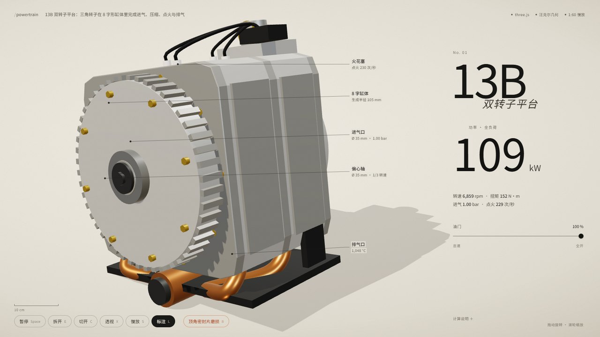
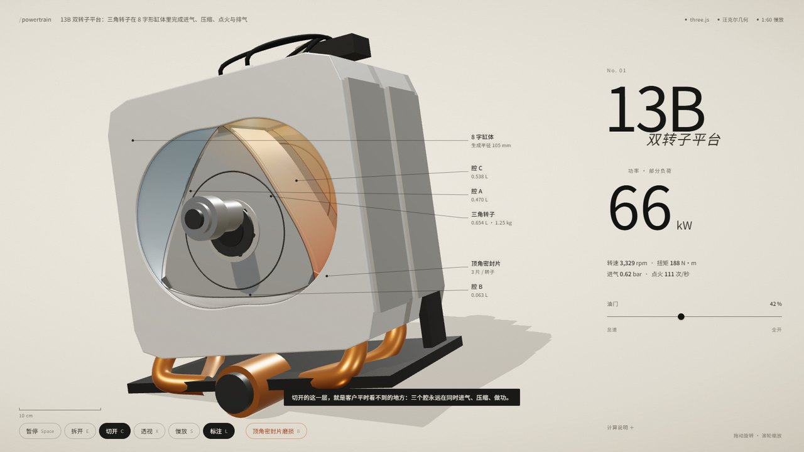
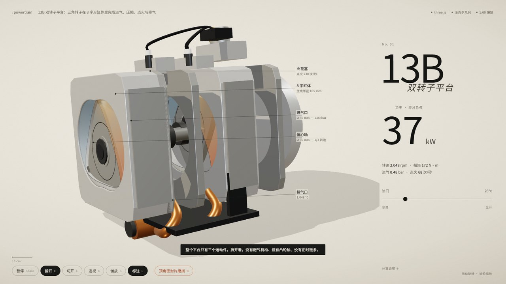
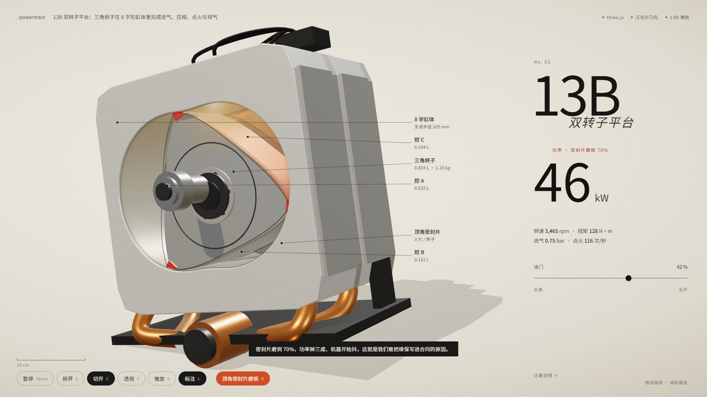

# engine-sales-demo

把一台发动机做成客户能自己拆的 60 秒：可交互 3D 销售演示 + 演示脚本 + 一套可复用的 Skill。




## 这是什么

工业品销售最常见的丢单理由不是产品不行，是「客户看不出差异，只能比价」。这个仓库把「参数背后看不见的东西」做成客户能拖、能点、能拆的交互演示：

- **切开**：移开前盖，露出 8 字缸体和三角转子，三个工作腔按进气/压缩/做功/排气着色，容积实时变化
- **拆开**：沿偏心轴把缸体、隔板、双转子一层层拉开
- **透视**：外壳半透明，看内部布局
- **油门**：0–100% 联动转速、扭矩、功率（P = T·2πn/60，实时算）
- **故障**：顶角密封片磨损 70%，功率下降、密封片变红、抖动，可恢复
- **标注**：零件引线 + 实时腔体容积

单文件 HTML，双击就开，不联网也能用。




## 快速开始

### 只是看看

双击 `assets/demo/双转子平台-销售演示.html`。

### 换成你的产品

```bash
git clone <this-repo> && cd engine-sales-demo/assets/demo
# 改 src/spec.js：品牌、产品名、参数、六条标注、四句销售话术
python build.py
```

需要 Node（构建时用 esbuild 打包）。不想装环境就直接改单文件 HTML 里的文案。

### 让 AI 帮你做

把仓库丢给 Claude Code / DeepSeek Harness / Cursor，说：

> 读 SKILL.md，按 references/spec-template.md 问我问题，然后帮我把这套演示改成 [你的产品]。

## 目录

```
SKILL.md                     Skill 主文件（给 AI 读的工作流）
references/
  sales-playbook.md          客户想确认什么、卖点怎么翻译、三套脚本
  prompt-library.md          四个提示词：生成 / 改造 / 写脚本 / 自检
  acceptance.md              8 条验收 + 截图脚本
  spec-template.md           开工前要填的表
assets/demo/
  双转子平台-销售演示.html      可直接运行的成品
  src/spec.js                产品配置（改这里）
  src/app.js                 Three.js 场景、装配、物理、交互
  src/geom.js                汪克尔几何：缸体型线 + 转子包络
  build.py                   打包成单文件
examples/13b/spec.md         13B 平台的填表示例
```

## 为什么是「发动机 + 演示」而不是「一个 3D 模型」

一个会转的模型解决不了销售问题。这套东西的顺序是：

1. 先写客户最常问的 5 个问题
2. 把每个问题翻译成一个镜头
3. 每个镜头配一个交互、一句人话
4. 最后才是建模和代码

细节在 `SKILL.md` 和 `references/sales-playbook.md`。

## 技术说明

- Three.js r180，单文件内联，无外部请求
- 汪克尔几何按真实参数算：生成半径 R = 105 mm，偏心距 e = 15 mm；转子廓线是缸体的数值内包络
- 为了让三角在剖面里看得清，转子廓线做了 1.38 次幂的视觉收窄（真实包络在剖面里几乎是个圆）
- 燃烧用颜色和闪光表示，不是 CFD；数字由扭矩曲线和 P = T·ω 实时求得

## 数据引用

文中引用的行业数据来自公开来源（Gartner 2025、Demand Gen Report 2024、CGI Backgrounds 2025、Storylane/Factors.ai、Shopify 3D 内容报告），仅作方向参考，不构成效果承诺。

## License

MIT
